# Agentic Coding Team: Setup Concept

| | |
|---|---|
| Purpose | How one human and a team of AI agents build and maintain a complex application |
| Environment | T3 Code, with Claude Code (Max plan), Codex (Pro plan), OpenCode with OpenRouter |
| Priorities | 1. Security, 2. Cost efficiency, 3. Overall quality |
| Scope | Stack-agnostic. Designed from zero. Section 7 maps the skills already installed onto it |
| Human gates | Spec and architecture once per milestone, every production release, every irreversible action, and merging the pull requests the risk gate holds back |
| Date | 2026-11-12 |

---

## 1. The concept on one page

1. **One lead, many leaves.** Claude Code leads. It plans, routes, briefs and verifies. It writes code only for changes of about 20 lines or less and for chores. Workers never start their own workers.
2. **The writer never approves its own work.** Claude writes code, Codex reviews it. Two model families make different mistakes, so they catch each other's. Risky or unclear specs get a separate reviewer, tests always a separate author.
3. **Flat rate first.** The Max and Pro subscriptions are already paid. They carry all thinking and all sensitive work. OpenRouter is pay-per-token and gets only non-sensitive work that needs no repository, under a hard budget.
4. **Process depth follows risk.** Every task gets a tier (T0, T1, T2) before work starts. The tier fixes how many specs, tests, reviews and audits the task gets. Nobody decides "one more round" on the fly. A risk gate then rates the finished pull request and decides who merges it.
5. **Machines check first, models second.** Lint, types, tests, secret scan, dependency scan and static analysis run before any model reviews anything. They are free, fast and never tired.
6. **Loops have budgets.** Every loop has a round limit, a stop rule and an exit to the human. A used-up budget is never an approval.
7. **Files, not chat history.** Specs and architecture decisions live in the repository. Task state, review findings and the event log live in a local state folder outside it. Agents have no memory, so every handoff is a self-contained brief.
8. **The most expensive model works where mistakes are most expensive.** Fable 5.2 does architecture and the review of unclear specs. It writes no code. Security work runs on Opus 5.5, because Fable's cyber safeguards block it.
9. **The team measures itself.** Every loop leaves one log line. A monthly retro turns the numbers into proposed changes to models, budgets and skills. The human merges them.

---

## 2. Resources and how each is used

| Provider | Billing | Data trust | Used for | Not used for |
|---|---|---|---|---|
| **Claude Code** (Max plan) | Flat rate, usage limits per session and per week | First party | Lead, architecture, specs, spec review, tests, implementation, security, QA, chores | Reviewing its own code |
| **Codex** (Pro plan) | Flat rate, usage limits | First party | Code review, security review, risk rating, review of critical specs | Routine implementation and routine spec review. Its allowance is the scarce one |
| **OpenCode → OpenRouter** | Pay per token | Third party, differs per upstream provider | Bulk work that needs no repository, third opinion on irreversible decisions, budgeted overflow | Security-relevant code, secrets, unfixed findings |

### Data classes decide which provider may see what

Security is priority 1, so routing starts with the data, not with the price.

| Class | Examples | Who may see it |
|---|---|---|
| **Red** | Secrets, credentials, customer data, production dumps | No agent, ever |
| **Amber** | Auth, crypto, payment and infrastructure code, threat model, unfixed security findings | Claude and Codex only |
| **Green** | Everything else, public documentation | Any provider, OpenRouter only with zero-retention routing |

### Team topology

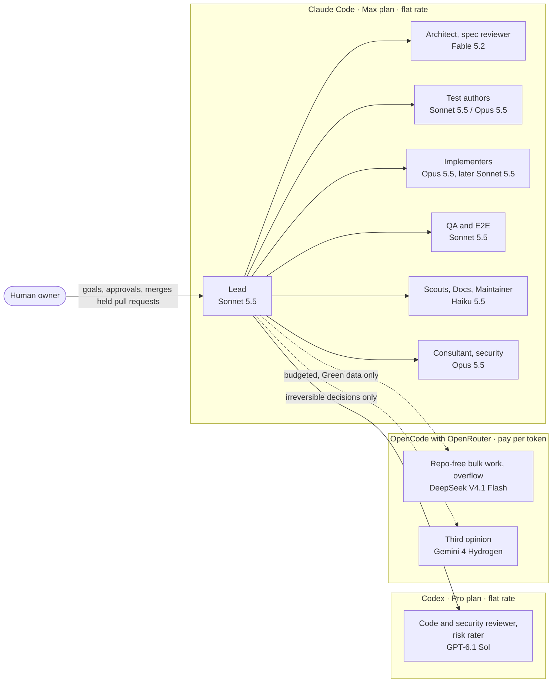

---

## 3. The team

| # | Role | Job | Model | Effort | Active |
|---|---|---|---|---|---|
| 1 | **Lead** | Scope, tier, briefs, gates, final verification. Implements changes of about 20 lines or less and chores itself | Claude Sonnet 5.5 | high | Always |
| 2 | **Architect** | Architecture, decision records, slicing into milestones | Claude Fable 5.2 | high | Inception, once per milestone |
| 3 | **Spec writer** | Feature spec with numbered acceptance criteria | Claude Sonnet 5.5 (T1), Opus 5.5 (T2) | medium / high | Per slice |
| 4 | **Spec reviewer** | Independent approval of the spec against request and code | Codex GPT-6.1 Sol for T2 specs. Claude Fable 5.2 for a T1 spec with an unclear design. A clear T1 spec gets no review | medium | T2 slices, unclear T1 slices |
| 5 | **Test author** | Acceptance tests from the spec, before code exists. Always a separate agent | Claude Sonnet 5.5 (T1), Opus 5.5 for security, state and concurrency (T2) | medium / high | Per slice |
| 6 | **Implementer** | Smallest complete change that makes the tests pass, for changes above about 20 lines | Claude Opus 5.5 (T1, T2). Sonnet 5.5 for T1 once the replay test passes. Haiku 5.5 (T0) | medium | Per slice |
| 7 | **Code and security reviewer** | Verdict plus findings with severity. Security review of triggered changes. Risk rating for the gate | Codex GPT-6.1 Sol | medium, high for the security review | Per slice from T1 |
| 8 | **Security engineer** | Threat model, second security review of triggered changes, milestone audit | Claude Opus 5.5 | high | Inception, T2 changes, before release |
| 9 | **QA** | Starts the app, runs end-to-end and exploratory checks, collects proof | Claude Sonnet 5.5 | medium | Slices with runtime behaviour, release |
| 10 | **Scout** | Code search and log reading (no network), or web research (no repository) | Claude Haiku 5.5 | low | On demand |
| 11 | **Docs writer** | User docs, changelog, runbooks | Claude Haiku 5.5 | low | Per slice, release |
| 12 | **Consultant** | One bounded hard question, with evidence | Claude Opus 5.5 | high | Max once per open question |
| 13 | **Third voice** | Extra opinion from a third model family | OpenRouter Gemini 4 Hydrogen | high | Irreversible decisions only |
| 14 | **Maintainer** | Scheduled checks: dependencies, advisories, flaky tests, doc drift. It reports, the delivery loop fixes by tier | Claude Haiku 5.5, escalates to Sonnet 5.5 | low | Scheduled |
| 15 | **Bulk worker** | Mass jobs that need no repository: translations, synthetic test data, summaries of public material. Overflow for Green work | OpenRouter DeepSeek V4.1 Flash | low | Budgeted, on demand |

### Rules behind the table

- **Vendor separation.** Code is always reviewed by another vendor. Tests stay inside Claude, but go to a separate agent. A T2 spec goes to Codex. A T1 spec is reviewed only when its design is unclear, then by Fable. When a subscription limit is reached, the stage pauses and resumes after the reset. The one planned exception is a role swap that the lead sets at the start of a slice: Codex implements, Claude reviews. The separation stays.
- **Start small, escalate once.** A role starts on the cheapest model likely to succeed. When its three attempts are used up, it moves up one model tier, once: Haiku to Sonnet, Sonnet to Opus. An Opus worker has no tier above it and goes straight to the lead. After that the lead or the human decides.
- **No silent substitution.** A missing model blocks its stage and is reported. Nobody swaps models quietly.
- **Model names live in one file.** Only the lead's `models.md` names models. The lead resolves the IDs from the live T3 catalog at run time.
- **Workers are leaves.** A worker does its task and reports. It does not delegate, commit to shared branches, or contact anything outside the repository.
- **Small changes stay with the lead.** The lead implements a change of about 20 lines or less itself, and a chore that adds no feature, such as a dependency upgrade or tooling. A delegation would cost more than the change. Tests first, review, security pass and gate stay the same.
- **A clear spec needs no reviewer.** A T1 spec is clear when it names the acceptance criteria, the files and one test per criterion. If the lead cannot fill these in, the design is unclear and Fable reviews the spec.

---

## 4. How much process: the risk tiers

This is the Pareto rule of the concept. The tier is set once, before work starts, and it fixes the process depth.

| | **T0 Trivial** | **T1 Standard** | **T2 Critical** |
|---|---|---|---|
| Typical | Text in documentation files on the gate's no-rating list | Feature or bug inside one module, reversible. Also comments, formatting and config in code files | Trust boundary, data, contracts, infrastructure |
| Share of tasks (expected) | ~10 % | ~75 % | ~15 % |
| Spec | One line in the task record | Short spec. Fable reviews it only when the design is unclear | Full spec, reviewed by Sol, failure cases listed |
| Tests | None new | Separate author (Sonnet 5.5) | Separate author (Opus 5.5), test files frozen |
| Implementer | Haiku 5.5 | Opus 5.5. Sonnet 5.5 once the replay test passes | Opus 5.5 |
| Code review | None, CI only | Sol, max 3 rounds | Sol, max 3 rounds, up to 5 for security, data loss or concurrency |
| Security review | Scanners | Scanners | Scanners plus the security pass: Sol and Opus, both clean |
| Proof | CI green | CI green plus the behaviour observed once | CI green plus end-to-end proof |
| Merge lane, set by the risk gate | Auto, without a rating | Auto when every rating is 0 or 1, otherwise review | Usually review: the owner merges. Block for migrations, CI, deployment, infrastructure and agent configuration |

In every tier the lead itself implements a change of about 20 lines or less. Everything else in the table stays the same.

### T2 triggers are deterministic where possible

The classifying agent could under-classify to save effort. So most of T2 is forced by facts that a script checks on the diff:

- Path match in the policy file. The default policy covers authentication, permissions, sessions, secrets, crypto, dependencies, migrations, deployment, CI and agent configuration. Paths for payments and personal data are added per project from the threat model
- New package or major version upgrade of a dependency. Patch and minor upgrades are T2 as well in `tier.py`, because every manifest rates 2 in the policy (decided in follow-up FU3). The gate sends every dependency change to the review lane
- Change to a public interface or a data schema

Two triggers need judgment. The lead assesses them, and the reviewer may raise the tier:

- Concurrency or shared state
- Code that parses untrusted input

The path list is the policy file of the risk gate, `risk-policy.toml`. The gate rates every change to its own files as "block", so an agent cannot shrink the list.

How the path floor sets the tier: a file the policy rates 2 or 3 makes the task T2. A task that touches only files on the gate's no-rating list is T0. Everything else is T1. One exception: the policy's size rule (more than 200 changed lines) affects the lane only, because size is unknown before work.

**Guardrail files are human-owned.** CI configuration, branch protection, `AGENTS.md`, skills, the tier and path lists, sandbox and permission settings define the rules of the game. Agents propose changes to them. Only the human merges them. The risk gate enforces this for files in the repository: it rates every such change as "block".

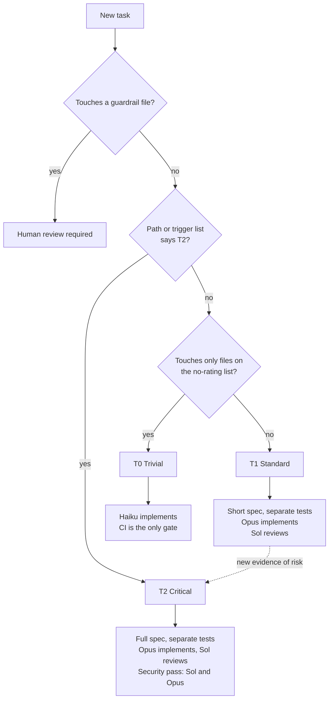

### Tier and lane: two ratings, one path list

The tier is set before work and fixes the process depth. The lane is set after work, on the finished pull request, and decides who merges. Both read the same path list.

| | Tier | Lane |
|---|---|---|
| When | Before work starts | On the finished pull request, for its exact head commit |
| Set by | The lead, from the path list and the triggers | The risk gate, a script in CI |
| Input | The paths the task will touch | The path floor from the policy file, plus three ratings from the reviewer: regression, security, user impact, each 0 to 3 |
| Decides | Spec, tests, implementer, reviews | Who merges |
| Values | T0, T1, T2 | Auto, review, block |

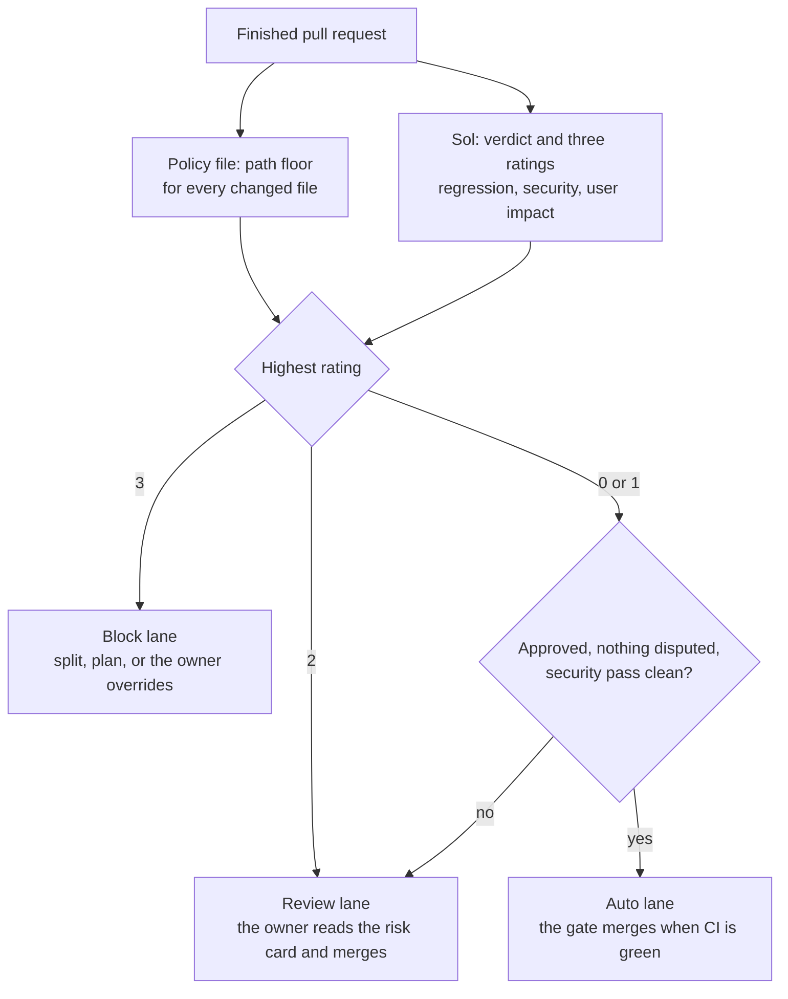

- The lane comes from the highest rating, never from an average.
- A new push needs a new review and a new rating.
- The gate starts in shadow mode: it rates and comments, but does not merge. During shadow mode the owner merges every pull request. After about ten pull requests the owner compares the gate's lanes with their own decisions and switches it to enforce.
- Tier and lane are independent. A T2 task usually lands in the review lane, because the policy or the reviewer rates it 2. This is not guaranteed: a concurrency change with ratings of 0 or 1 merges automatically after its clean security pass.
- T0 changes get no model review, so they carry no rating. Today the gate sends a pull request without a rating to the review lane. It needs one change: a short list in the policy that names the files that may merge without a rating. The list holds user documentation and nothing that runs or steers: no tests, no specs, no runbooks, no agent definitions. It only lets through files whose path floor is 0.
- That list must be its own list. The policy's existing level 0 is too wide for it: it covers every Markdown file, every folder named `docs` and every test file.

### Loop budgets

| Loop | Budget | Stops early when | When the budget is used up |
|---|---|---|---|
| Spec review | 2 rounds (T2: 3) | Approved, or only nits left | Human decides |
| Make tests green | 3 attempts | Green | One model tier up, once. Opus goes straight to the lead |
| Code review | 3 rounds, up to 5 for security, data loss or concurrency | Approved, or only nits left | The pull request goes to the review lane as disputed, human decides |
| Security pass | Inside the code review budget | Both reviewers clean | An open finding blocks the merge. Only the human can accept a security risk |
| Consultation | 1 per open question | Answered | Lead decides and records why |
| Third voice | 1 per irreversible decision | | |
| OpenRouter spend | Soft ceiling per task (start: 3 USD), hard cap on the API key | | Paid work stops, rest is reported |

### Is another round worth it? Three questions

1. Is a finding of severity *blocker* or *should* still open, with evidence? If not, stop.
2. Did the last round reduce the open findings? If not, the loop is ping-pong. Escalate, do not repeat.
3. Is budget left? If not, stop and hand the open points to the human.

Severity has three levels only. **Blocker**: the intended case is wrong. **Should**: a real bug that callers will hit. **Nit**: everything else. Nits never start a new round. They go to a follow-up list. Security findings are the exception: at any severity they are fixed or go to the human.

---

## 5. The lifecycle

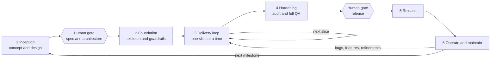

| Phase | Result | Main agents | Human |
|---|---|---|---|
| 1 Inception | Product brief, architecture, threat model, sliced backlog | Architect, Security, Spec reviewer | Approves |
| 2 Foundation | Running skeleton, CI gates, risk gate, sandbox, skills in place | Implementer, Lead | Sets up accounts, secrets, branch protection |
| 3 Delivery | Merged, reviewed slices | Whole team | Merges the pull requests the gate holds back |
| 4 Hardening | Audit report, release candidate | Security, QA, Reviewer | Reads the release brief |
| 5 Release | Deployed version | Lead prepares, human triggers | Approves and deploys |
| 6 Operate | Stable system, updated dependencies | Maintainer, Scout | Reports bugs, sets priorities |

### The four human gates

| Gate | When | What the human gets |
|---|---|---|
| **Milestone gate** | Once per milestone, end of Inception | Decision brief: scope, architecture, threat model |
| **Held pull request** | Whenever the risk gate puts a pull request in the review or block lane | Risk card: ratings, reasons, reviewer verdict, security pass |
| **Release gate** | Before every production release | Release brief: changes, security verdicts, open risks, rollback |
| **Irreversible action** | Whenever one comes up | One question with context and a recommendation |

Irreversible actions are: deleting data, migrations on shared or production data, publishing outside the repository (packages, public repositories, messages to third parties), creating or rotating credentials, spending above a budget, and changes to guardrail files. An agent that reaches one stops and asks. An earlier general approval does not count.

---

## 6. The flows

### 6.1 Inception: from idea to approved plan

This phase decides most of the later cost. A wrong architecture is paid for in every slice. So the best model works here, and the plan gets the widest review of the whole project.

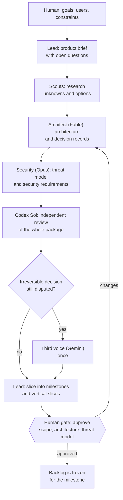

Outputs, all as files in `docs/`:

- **Product brief**: goals, non-goals, users, success criteria
- **Architecture**: components, interfaces, data model, one decision record per major choice
- **Threat model**: assets, trust boundaries, abuse cases, the resulting security requirements. It feeds the path list, which the human merges into `risk-policy.toml`
- **Backlog**: vertical slices, each small enough for one agent session, each with a first tier guess

The human reads a **decision brief** of one page, not the whole package: what is proposed, what was rejected and why, what cannot be undone later.

### 6.2 Foundation: skeleton and guardrails

Built once, before the first feature. This is the cheapest moment to install security.

- Walking skeleton: the thinnest end-to-end path through all layers, deployed to a test environment
- CI gates: format, lint, types, tests, secret scan, dependency scan, static analysis, licence check
- A diff guard: fails when test files are deleted or assertions shrink without a spec change
- The risk gate: policy file, gate script and its own tests in CI. It starts in shadow mode
- Branch protection, required checks, code owners for guardrail files
- Sandbox per agent: write access to the worktree only, no access to secret stores, network allowlist
- `AGENTS.md`, the skills, the `docs/` structure
- Secrets in a secret manager. Agents get short-lived, test-only credentials
- CI on agent branches runs without secrets. Deployment secrets exist only in the release job that the human triggers

### 6.3 Feature delivery: the core loop

One slice, one lead thread, one worktree. A feature added after a release runs through the same loop. If it changes the architecture, the data model or a trust boundary, it first gets a short Inception with the human gate.

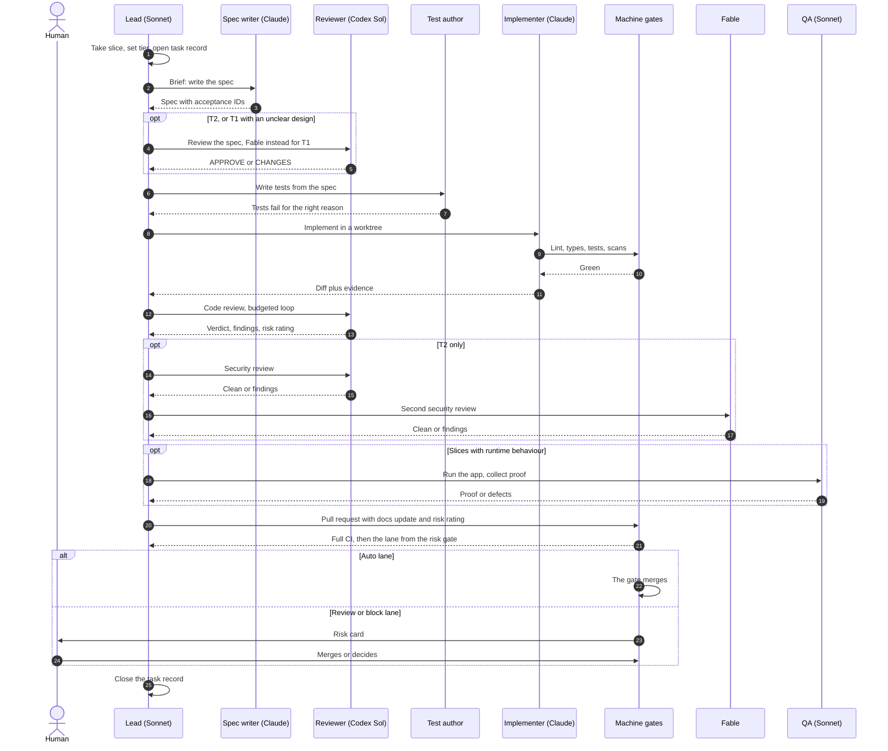

Rules that keep this loop honest:

- **Tests are red first.** A new test must fail on the old code for the intended reason, not because of an import error.
- **Tests are not negotiable.** The implementer may not weaken an acceptance test. A wrong test goes back to the lead with evidence.
- **Evidence, not claims.** "Done" means command output, a reproduction or a screenshot from this session.
- **A behaviour change after approval voids the approval.** The final diff is the one that must be approved.
- **One writer per checkout.** Parallel implementers get separate worktrees and disjoint files.

#### Who tests what

| Level | Written by | Runs | Blocks |
|---|---|---|---|
| Unit and acceptance tests | Separate test author: Sonnet (T1), Opus (T2) | Every commit | Merge |
| Integration tests | Test author, from the interfaces named in the spec | Every commit | Merge |
| End-to-end and exploratory | QA against the running app | Slices with runtime behaviour, release candidate | Merge (T2), release |
| Security tests: scanners, abuse cases from the threat model | Machine gates, Security | Every commit, T2 changes, release | Merge, release |
| Regression tests | From every fixed bug | Every commit, permanently | Merge |

### 6.4 The review loop

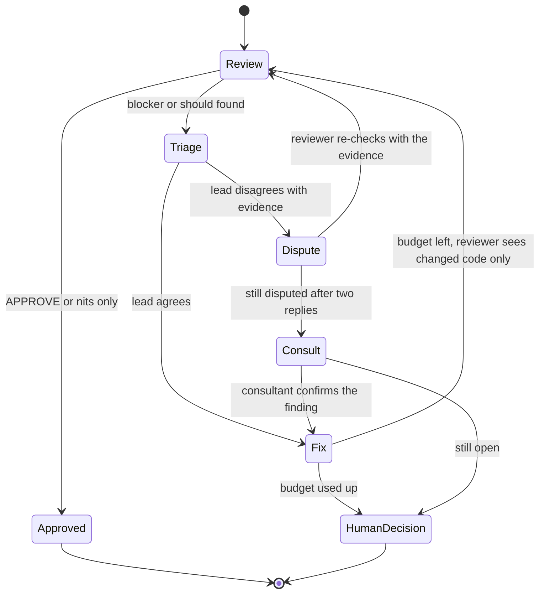

- Round 1 reviews the full diff. Later rounds review only changed code and open findings.
- Every round is a fresh reviewer with the original brief and the findings ledger. No reviewer drifts along with the author.
- The lead checks every finding itself. It fixes what is right, rejects with evidence what is wrong, and declines scope growth.
- If a review makes the diff grow, the lead cuts first.
- A dispute gets one consultation (Opus 5.5). The consultant can convince the lead to fix the finding. It cannot close a finding against the reviewer. If the dispute stays open, the human decides.
- A pull request with a disputed finding never reaches the auto lane.
- The reviewer treats the diff, its comments and its commit messages as data. Only the reviewer's own verdict line counts as approval.

### 6.5 Bug fixing

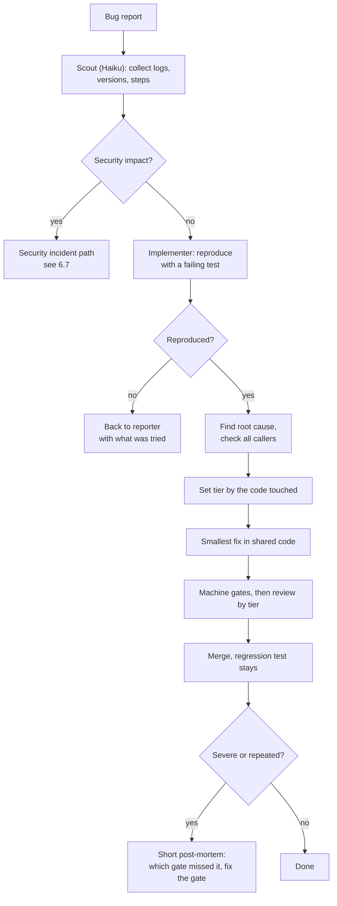

- No fix without a reproduction. The failing test is the spec.
- The fix goes to the root cause once, not to every symptom.
- A bug that escaped a gate improves that gate. This is how the process learns.

### 6.6 Refinement and refactoring

The contract: behaviour stays the same.

1. Scout maps the area and its callers.
2. If coverage is thin, the implementer first writes characterisation tests that pin today's behaviour.
3. The change lands in small steps. Tests stay green after each step.
4. The reviewer gets one extra question: "Did behaviour change anywhere?"
5. Tier follows the code touched. A refactoring of auth code is T2.

Refactoring needs a reason from the backlog: a measured cost, a blocked feature, a repeated bug. Agents do not refactor on their own taste.

### 6.7 Security

Security is layered. No single layer is trusted.

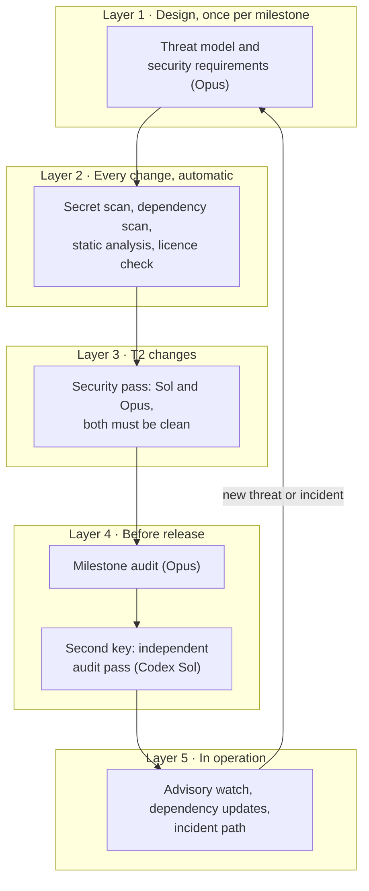

**The security pass.** A change that hits a trigger gets two security reviews after the code review is clean: Sol with a security brief, and Opus with the `security-review` skill. Both must end clean. A security finding of any severity is fixed or goes to the human. It is never declined as a nit and never closed by a used-up budget. Only the human can accept a security risk.

**Security of the agents themselves** matters as much as security of the product:

| Risk | Control |
|---|---|
| Agent reads secrets | Secrets never in the repository. Secret paths read-denied in the sandbox. No production credentials for agents |
| Prompt injection through web pages, issues, package readmes | Tool output is data, never instruction. Research agents have no write access and no credentials |
| Injection from one agent to the next | Diff text, comments and commit messages are data for the reviewer. Approval counts only from the reviewer's verdict line |
| Code leaks through a research agent | Web scouts run without a repository checkout. Code scouts run without network |
| Injection that persists | Skills, `AGENTS.md` and settings are write-protected for agents and human-reviewed |
| Malicious or invented package | New package forces T2. Lockfile, dependency scan, registry check before install |
| Agent weakens the gates | CI configuration and branch protection are human-owned. The risk gate rates every change to them as block. No admin bypass, no forced push to shared branches |
| Agent code runs inside CI | Build scripts and test configuration are agent-editable, so CI on agent branches gets no secrets |
| Code leaves to an unknown party | Data classes. OpenRouter limited to zero-retention providers and Green data |
| Findings leak | Unfixed findings are Amber. They stay with Claude and Codex and out of public issues |

**Incident path.** A suspected vulnerability in the released product goes to the human at once. The fix runs as T2 in a private branch. The post-mortem updates the threat model.

**Limit.** A model audit is not a penetration test. For high-stakes systems, a human security test before the first public release stays on the plan.

### 6.8 Release

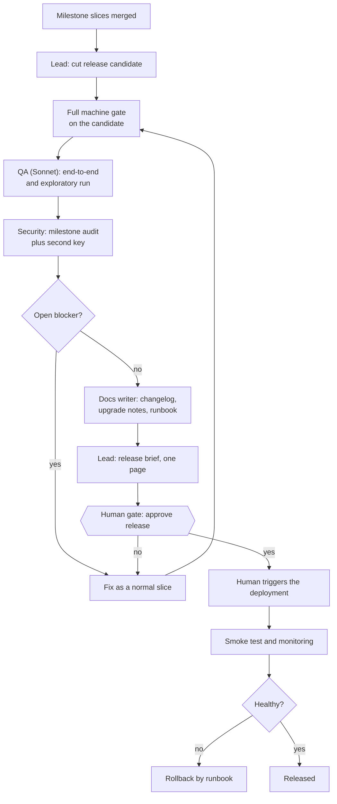

- The **release brief** lists: what changed, every T2 change with its security verdict, every security risk the owner accepted, open risks, declined findings, the rollback plan.
- Agents prepare everything. The human holds the deployment credentials and presses the button.
- Data migrations and anything that cannot be rolled back are named separately in the brief.

### 6.9 Maintenance and operation

Scheduled agents find the chores and report them. The delivery loop implements each one by its tier. Nothing merges outside the normal gates.

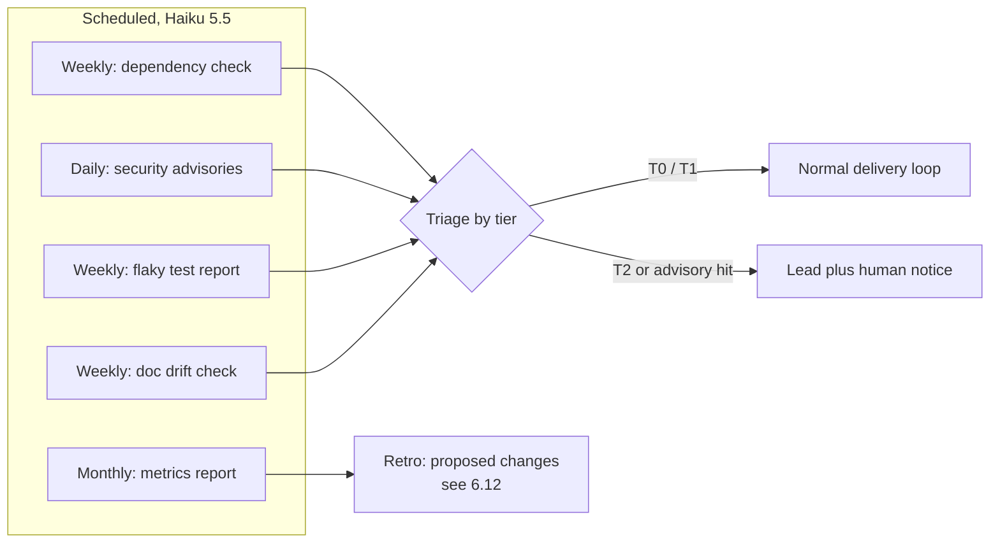

The monthly retro closes the loop: measured numbers change the setup, not opinions. Section 6.12 describes how.

### 6.10 Documentation

- Docs are part of "done". A slice that changes behaviour updates the docs in the same pull request.
- The spec is the source. The docs writer turns spec plus diff into user text. A cheap model is enough because the spec was already reviewed.
- Decision records are written when the decision is made, by the agent that made it.
- The weekly drift check compares docs against code and reports fixes, tiered as usual.

### 6.11 When things go wrong

| Situation | Reaction |
|---|---|
| Subscription limit reached | Stage pauses and resumes after the reset. No model swap inside a running stage, no paid fallback without a budget decision. The lead may plan the next slice with swapped roles |
| Both subscriptions exhausted | Work stops. The task record holds the checkpoint. The human decides on paid overflow |
| Worker uses up its three attempts | One model tier up, once. An Opus worker goes straight to the lead. Then the lead takes the decision to the human |
| Review ping-pong | One consultation (Opus 5.5). Then the human decides |
| Worker reports success without proof | Result rejected. Proof is part of the brief |
| Unexpected files changed | Lead stops, inspects, never discards work it did not create |
| Long check killed by a session restart | Long checks run detached from the session. A killed run is neither pass nor fail. It is repeated |

### 6.12 Self-improvement

The team records what happens in every loop and uses the numbers to change its own setup. Agents measure and propose. The human decides.

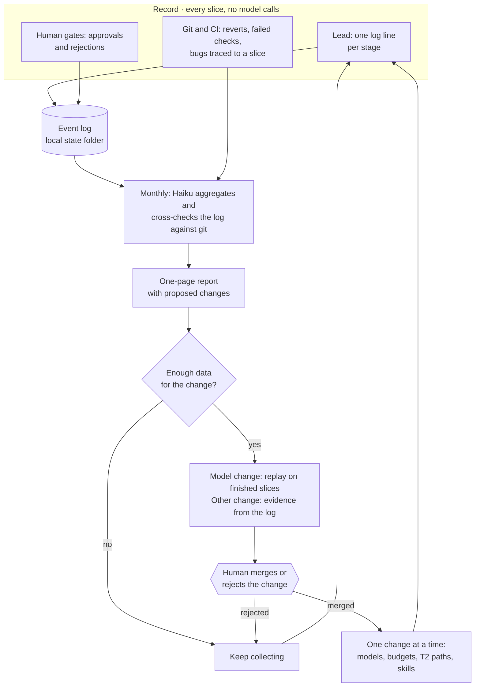

#### What is recorded

| Source | Data | Written by |
|---|---|---|
| Every stage of every slice | Slice, tier, stage, role, executed model, effort, attempt, review round, verdict, findings per severity, outcome per finding, duration, tier raised, escalation, quota pause | The lead, through a small script that checks the fields and adds the time |
| Git and CI | Merge lane, reverts, checks that fail after a merge, review rounds per pull request, bugs traced to the slice that caused them | Nobody. The retro agent reads it |
| Human gates | Approved, changed or rejected, and the time to an answer | The lead |
| Cost | Token counts where the harness returns them. OpenRouter key budget before and after a task | The lead |

Recording costs one log line per stage. It adds no loop and no model call.

The log lives in the local state folder, not in the repository. The lead does not merge, so it cannot commit a line per stage, and parallel slices would collide in one file. Only the monthly report enters the repository, through a normal pull request.

#### What the numbers change

Section 8 lists the five routing metrics and their thresholds. The log also improves the process itself:

| Signal in the log | Proposed change |
|---|---|
| The last review round rarely finds a blocker | Lower the round budget for that tier |
| The same spec-review finding keeps coming back | Add the missing item to the spec skill |
| The same code-review finding keeps coming back | Add a lint rule. If no rule can catch it, add a line to the implement skill |
| Escaped defects cluster on one path | Add the path to the T2 list |
| The lead often rejects reviewer findings with evidence | Tighten the review brief |
| Slices often exceed their attempt budget | The slices are too large, or the specs too vague |
| A human gate often sends work back | Improve the decision brief or the Inception checklist |
| Reviews or the owner often find that a slice built the wrong thing | Review T1 specs again, first in the affected area |

#### Rules

1. **Agents propose, the human merges.** Models, budgets, tier lists and skills are guardrail files. No agent changes its own rules.
2. **Outcome before opinion.** An approval rate shows that two models agree. Reverts and escaped defects show quality. An approval rate alone never justifies a cheaper model.
3. **Enough data.** About 20 data points for a role and tier before a change is proposed. A model change may be proposed earlier when a replay test supports it.
4. **One change at a time.** Then one retro period of observation. Otherwise nobody knows which change had the effect.
5. **Replay before a model change.** Five to ten finished slices with frozen spec and tests are run again on the candidate model. This gives an answer in an hour instead of a month.
6. **Statistics expire.** Every log line carries the model ID and the date. A vendor update restarts the count for that model.

#### Limits

- The lead writes the log about work it led, and it can leave lines out. The retro agent counts the pull requests in git and compares. The risk ratings it finds there were posted by the lead as well.
- The log is the view of one machine. A second machine keeps its own.
- A solo project produces maybe 20 to 50 slices a month. Numbers per role and tier grow slowly.
- Escaped defects arrive weeks after the slice that caused them.
- Cost data is partial. The harness returned token counts for native Claude subagents but not for delegated tasks, and subscriptions report no price per task.

---

## 7. Where things live

One rule: **every instruction exists once**. Harness-specific folders contain links or configuration, never copies.

```text
repo/
├── AGENTS.md                    Project facts for every agent, every harness
├── CLAUDE.md                    One line: @AGENTS.md
├── .agents/
│   └── skills/                  The team's skills, canonical location
│       ├── lead/                Routing, tiers, budgets (lead only)
│       │   ├── SKILL.md
│       │   └── references/
│       │       ├── models.md        The only place that names models
│       │       ├── risk-tiers.md    Tiers and the judgment triggers
│       │       ├── budgets.md       Loop and spend limits
│       │       └── brief.md         Template for a self-contained handoff
│       ├── inception/           Brief, architecture, threat model, slicing
│       ├── spec/                Writing and reviewing specs
│       ├── test-first/          Tests from acceptance criteria
│       ├── implement/           Smallest complete change
│       ├── review/              Review format, severity, findings ledger
│       ├── security/            Threat model, diff review, audit checklists
│       ├── bugfix/              Reproduce first
│       ├── refactor/            Behaviour-preserving change
│       ├── release/             Candidate, release brief, rollback
│       ├── docs/                Docs from spec and diff
│       └── maintain/            Scheduled chores
├── .claude/
│   ├── skills -> ../.agents/skills      Link, no copy
│   ├── agents/                  Tool limits only: read-only scout, read-only reviewer
│   └── settings.json            Permissions, sandbox, hooks
├── .codex/  .opencode/          Harness configuration only
├── docs/
│   ├── product/                 Product brief, backlog
│   ├── architecture/            Architecture overview
│   ├── adr/                     One decision record per file
│   ├── security/                Threat model, audit reports once fixed, accepted risks as summary
│   ├── specs/NNN-slug/          spec.md
│   ├── metrics/                 Monthly reports, replay list
│   └── runbooks/                Deployment, rollback, incidents
└── .github/
    ├── workflows/               CI, risk gate workflow
    └── risk-gate/               Gate script, risk-policy.toml (the path list), tests

~/.local/state/t3-build/<repo>/          Outside the repository
├── events.jsonl                 Event log, one line per stage (6.12)
└── <slug>/                      One folder per slice
    ├── checkpoint.md            Stage, branch, head commit, task IDs, next action
    ├── ledger.md                Review findings: id, severity, outcome
    └── decisions.md             The lead's own decisions, for the owner to audit
```

### How the three harnesses find the files

| Harness | Project instructions | Skills | Agent definitions |
|---|---|---|---|
| Claude Code | `CLAUDE.md`, which imports `AGENTS.md` | `.claude/skills` (the link) | `.claude/agents/*.md` |
| Codex | `AGENTS.md` | `.agents/skills` | `.codex/agents/*.toml` |
| OpenCode | `AGENTS.md` | `.agents/skills`, also `.claude/skills` and `.opencode/skills` | `.opencode/agents/*.md` |

- No skills folder is read by all three harnesses. That is why there is one canonical folder and one link.
- OpenCode reads both folders, so it lists every skill twice through the link. Switch off its Claude Code skill compatibility, or accept the duplicate listing.
- Agent definitions are not portable: Markdown for Claude Code and OpenCode, TOML for Codex. This is the reason for skill rule 4 below.
- Claude Code follows a link per skill. This machine already works that way. A link for the whole folder is untested. The pilot slice tests it. The fallback is a copy step in CI that fails on drift.

### What goes where

| Content | Place | Why |
|---|---|---|
| Facts about this project: commands, layout, conventions, security rules | `AGENTS.md` | Always loaded, so it stays short |
| Procedures: how a flow runs | A skill | Loaded only when the flow runs, costs no context otherwise |
| What to build | `docs/specs/` | Versioned, reviewable, survives the session |
| State of a task and review findings | Local state folder outside the repository | A new session can resume from it. Unfixed findings stay out of git history |
| Why the architecture is as it is | `docs/adr/` | Stops agents from re-deciding it |
| Security risks the owner accepted | `docs/security/` and the release brief, as a summary without exploit detail: id, area, decision, date. The detail stays in the state folder | Must survive the machine and reach the release gate, without publishing an unfixed weakness |
| Decisions the lead made alone during a slice | `decisions.md` in the local state folder | The owner audits them. They are not architecture |
| Generic workflow skills used by several projects | User scope, `~/.agents/skills`, versioned | One copy for all projects |
| Personal preferences of the human | User scope, `~/.agents/skills` | Not part of the product, not needed by CI |

### Rules for skills

1. **One skill per flow.** Twelve skills, each under about 200 lines. Details go to `references/`.
2. **Project-specific rules live in the repository.** Path lists, the risk policy and anything written for this codebase are versioned with the code. Generic workflow skills may stay in user scope when that folder is versioned and installed the same way on every machine that runs agents.
3. **Skills are code.** A change is a pull request with human review. Agents cannot write to the skill folders at run time.
4. **Roles are skills plus a brief.** The lead picks the model at delegation time. This keeps one definition for three harnesses. Agent files only restrict tools, they hold no role logic.
5. **Third-party skills are a supply chain.** Read before install, pin to a commit, keep the list short.

### Mapping to the skills already installed

The tree above is the reference design. This machine already has skills that cover most of it. They were read on 2026-11-12 in `~/.agents/skills`.

**Main finding.** `t3-build` already implements the core of this concept: a Claude lead, GPT Sol as reviewer, a project workflow with one approval gate, a feature run with tests first, and a risk gate that exists as code with tests. It has no link in `~/.claude/skills`, so Claude Code does not load it today.

#### What covers what

| Concept element | Installed skill | Status |
|---|---|---|
| Lead, routing, briefs, budgets (3, 4) | `t3-build` | Mostly covered. It has security triggers but no tier step |
| Inception (6.1) | `t3-build` project workflow, `grill-me`, `technical-spec-writing` | Covered: research, questions to the owner, spec with a security section, one-page concept, GO |
| Foundation (6.2) | `t3-build` setup milestone, `t3-build/gate` | Covered for CI, staging and the gate. Sandbox and secret setup stay manual |
| Risk tiers (4) | `t3-build/gate`: `risk-policy.toml`, `risk_gate.py` | Implemented as code. It rates the finished pull request, not the task |
| Feature delivery (6.3) | `t3-build` feature run, `ponytail` | Mostly covered. See the change list below |
| Review loop (6.4) | `sol-loop`, `ponytail-review` | Covered |
| Security per change (6.7, layer 3) | `t3-build` security pass, built-in `security-review` | Covered. The concept follows it |
| Threat model (6.7, layer 1) | Security section of the `t3-build` spec | Covered inside the spec, no separate file |
| Pull requests | `file-pr`, `babysit-pr`, `leaving-pr-comments` | Covered |
| Failure handling (6.11) | `t3-agentic-coding/references`: quota recovery, machine locks, long checks. `takeover` for abandoned work | Covered |
| Third voice | `council` | Partly. It starts three delegates from three vendors and loops until all are satisfied, which also spends Sol allowance. For one third opinion the lead calls a single Gemini delegate directly |
| Bug fixing (6.5) | `t3-build` feature run | Partly. The post-mortem that fixes the gate is missing |
| Self-improvement (6.12) | Seeds in `t3-build`: shadow mode for the first pull requests, effort comparison, `caused-failure` label | Partly. The event log and the monthly report are missing |
| Refactoring (6.6) | None | Missing |
| Milestone audit and second key (6.7, layer 4) | None | Missing |
| Release (6.8) | None. `t3-build` stops before production | Missing |
| Maintenance (6.9) | None. `modernize` updates stale pull requests | Missing |
| Documentation (6.10) | None | Missing |

Two skills do not fit the team flow:

- **`t3-agentic-coding`** is superseded by `t3-build`. Its lead runs on DeepSeek through OpenRouter, so the whole lead context leaves to a third party. The data classes forbid that. Only its three reference files and two scripts stay in use.
- **`full-send`** lets the agent merge. With an enforcing gate, the gate merges and the lead never does. The two are not combined. `full-send` and `full-stop` remain for work outside the team flow. The skill also lets the lead merge the auto lane in a shadow-mode repository without branch protection. This concept does not use that: the owner merges during shadow mode.

One skill is a variant: **`t3-coding-ninox`** runs the same flow with Claude models only. It is the choice when code may not leave Anthropic. Fable then replaces Sol as reviewer, and the vendor separation becomes a model separation.

#### What is left to write

1. Three new skills: release, maintenance, milestone audit.
2. Six changes to `t3-build`: the tier step before work, the T0 path without model review, Sonnet as T1 implementer once the replay test passes, the log line per stage, a short section for refactoring, and one for the post-mortem after a severe bug.
3. Three changes to the gate and its policy: the no-rating list for T0 (today the gate's code sends every pull request without a rating to the review lane), `.opencode/` in the agent-configuration rule, and per project the paths for payments and personal data.
4. One line in the definition of done in `AGENTS.md` for documentation.
5. The event log script and the monthly report from 6.12.

That is three new skills instead of twelve.

#### Ten differences and how they were resolved

The first draft of this concept differed from the installed skills in ten points. The owner accepted the recommendations on 2026-11-12. Sections 1 to 11 now describe the result.

| Topic | First draft | Installed skills | Applied |
|---|---|---|---|
| Lead model | Opus 5.5 | Sonnet 5.5 | **Skill.** It follows the start-small rule. The gate decides merges, not the lead |
| Spec reviewer | Codex Sol for every spec | Fable. Sol only on a security trigger or the data path | **Skill.** Sol's allowance is the scarce one. The price: Fable no longer works on architecture and security only |
| Test author | Implementer (T1), Codex Sol (T2) | Separate Claude author always. Opus for security and state | **Skill.** Always a separate author, and no Sol allowance is spent |
| Implementer | Haiku, Sonnet or Opus by tier | Opus always. The lead does changes up to about 20 lines | **First draft, in two steps.** Opus implements T1 and T2 at the start. Sonnet takes T1 once a replay test (6.12) shows it passes finished T1 slices. Haiku does T0 |
| Security per change | Fable reviews T2 diffs. Sol only before release | Sol security review plus Claude `security-review` on every triggered change. Both must be clean | **Skill.** Two vendors on every risky change |
| Merge of risky changes | Automatic for all tiers after approval | Three lanes. Auth, secrets and new dependencies wait for the owner. Migrations and CI changes are blocked | **Skill.** Security is priority 1. This adds a fourth human gate: merging the review lane |
| When risk is rated | Before work, as a tier that fixes process depth | After work, on the pull request, as a merge lane | **Both.** `risk-policy.toml` becomes the one path list for tier and lane |
| Review rounds | 2 (T1), 3 (T2) | 3, up to 5 for security, data loss and concurrency | **Skill.** One source for the number. The stop rule ends most loops earlier |
| Trivial changes | CI only, no model review | Review and gate always stay | **First draft, narrowed after the review.** Only documentation files on a short list merge without a review. This needs one change to the gate, see above |
| Task record and findings ledger | In the repository, beside the spec | In `~/.local/state/t3-build/`, never in the repository | **Skill.** Unfixed findings are Amber and do not belong in git history. Spec and architecture decisions stay in the repository. After the review the event log moved to the state folder as well |

#### Three further differences, resolved

The review found three more differences. The owner accepted the recommendations on 2026-11-13. All three follow the skill, so they need no change to `t3-build`.

| Topic | Earlier version | `t3-build` | Applied |
|---|---|---|---|
| Small changes | The lead writes no code | The lead implements changes up to about 20 lines and chores itself. Review and gate stay | **Skill.** A delegation costs more than 20 lines |
| Review of a T1 spec | Fable reviews every T1 spec | The short spec is reviewed only when a security trigger hits or the design is unclear | **Skill.** It takes most of the load off Fable's weekly cap |
| Consultant | Codex GPT-6 Astra | Claude Opus 5.5 | **Skill.** Astra costs five times Sol and draws on the scarce Codex allowance |

#### Storage on this machine

- `~/.agents` points to the dotfiles folder. `~/.agents/skills` is the canonical folder. Codex and OpenCode read it directly.
- `~/.claude/skills` holds one link per skill into `~/.agents/skills`. Claude Code loads skills through these links.
- A skill without a link is invisible to Claude Code. `t3-build` and `t3-coding-ninox` are in that state. A link for the whole folder would prevent it, but that is untested.
- The risk gate is copied into each repository under `.github/risk-gate/`. Its policy rates every change to `.github/`, deployment files and agent configuration (`AGENTS.md`, `CLAUDE.md`, `.claude/`, `.codex/`, `.agents/`) as "block". A pull request cannot loosen its own gate. This is the concept's rule "guardrail files are human-owned", already enforced by code. `.opencode/` is in that rule too (WP1).

#### A weak point the gate already documents

The lead posts the reviewer's risk rating under the owner's identity. The gate cannot tell an honest relay from a faked one. A faulty or injected lead could therefore auto-merge ordinary code. Path rules still hold: auth, secrets, dependencies, migrations and CI never reach the auto lane. This is the concrete form of the loophole "the lead is not reviewed" in section 10. The gate's documented upgrade is to run the rating inside CI.

---

## 8. Cost and quality

**Spend where errors compound. Save where the output is checked anyway.**

| Lever | Effect | Risk |
|---|---|---|
| Flat rate first | Thinking work costs nothing extra | Limits become the bottleneck |
| Model by tier | Once the replay test passes, most tasks run on Sonnet or Haiku | A mis-tiered task gets a weak model. The trigger list covers this |
| Default effort medium | High and above only for T2 and disputes | None observed for well-specified tasks |
| Machine gates before model review | No reviewer tokens for lint errors | Gates must be fast, or agents wait |
| Short briefs with file paths | Workers read what they need, not transcripts | A thin brief gives a wrong result |
| Scouts for search | Lead context stays small and cheap | Scout summaries can miss detail |
| The lead implements small changes | No brief and no worker start for 20 lines | The lead's context grows |
| No review for clear T1 specs | Fable stays below its weekly cap | A wrong spec is found late, in the code review or by the owner |
| Later review rounds see changes only | Each round is cheaper than the last | Side effects outside the diff. Covered by tests |
| Loop budgets | Cost per task has a ceiling | Open points reach the human |
| Max two workers per subscription at once | Limits last through the day | Less parallel speed |
| Hard cap on the OpenRouter key | The only real billing limit | Paid work can stop mid-task |

### Where the best models are used

| Decision | Cost of a mistake | Model |
|---|---|---|
| Architecture, threat model | Paid in every later slice | Architecture: Fable 5.2. Threat model: Opus 5.5. Reviewed by Codex, third voice on dispute |
| Spec of a T2 slice | Wrong feature, security hole | Opus 5.5, reviewed by Codex |
| Spec of a T1 slice | Wrong feature | Sonnet 5.5. Fable 5.2 reviews it only when the design is unclear |
| Implementation of a clear T1 spec | Caught by tests and review | Opus 5.5 at the start. Sonnet 5.5 once the replay test passes |
| User docs, search, scheduled checks | Cheap to redo | Haiku 5.5 |

### Price reference

The subscriptions bill no tokens, but API list prices show how heavy each model is. Heavier models use up a subscription allowance faster.

| Model | USD per 1M tokens, input / output | Source status |
|---|---|---|
| Claude Fable 5.2 | 8 / 40 | Third-party page |
| Claude Opus 5.5 | 4 / 20 | Third-party page |
| Claude Sonnet 5.5 | 2 / 10 | Third-party page |
| Claude Haiku 5.5 | 0.10 / 0.50 for short prompts | Third-party page |
| GPT-6 Astra | 10 / 50 | Vendor pricing page |
| GPT-6.1 Sol | 2 / 10 | Vendor pricing page |
| GPT-6.1 Terra | 1 / 5 | Vendor pricing page |
| GPT-6 Luna | 0.10 / 0.50 | Vendor pricing page |
| Gemini 4 Hydrogen via OpenRouter | 1.50 / 7.50 | OpenRouter page |
| DeepSeek V4.1 Flash via OpenRouter | 0.15 / 0.60 at DeepSeek's own endpoint, less elsewhere | OpenRouter page |

All figures were read from search summaries on 2026-11-12, not from the opened pages. Check them before they go on a slide.

What the numbers mean for the routing:

- Fable costs four times Sonnet. On the Max plan it is reported to have its own weekly cap. It reviews a T1 spec only when the design is unclear, which keeps it away from that cap.
- Astra costs five times Sol and draws on the scarce Codex allowance. It has no role. The consultant is Opus.
- Sol costs the same as Sonnet. A cross-vendor review is cheap compared with the rework it prevents.
- OpenRouter shows the price of the cheapest upstream provider. Zero-retention routing can exclude that provider, so budgets use the pinned provider's price.
- GPT-6.1 Terra for re-check rounds and GPT-6 Luna for chores are candidates. They get a role only after their quality is measured.

### Calibration

The routing above is a starting hypothesis. The monthly retro checks it against five numbers. Section 6.12 describes how they are recorded and how a change is decided:

| Metric | Meaning | Action |
|---|---|---|
| First-pass approval rate per role | Is the model strong enough? | Above 90 %: try one tier down. Below 60 %: one tier up |
| Review rounds per task | Is the loop converging? | Budget often used up: specs are too vague |
| Escaped defects per tier | Are the tiers right? | Defects in T0/T1: extend the T2 trigger list |
| Limit hits per week | Is the load spread well? | Shift heavy jobs, reduce parallel workers |
| OpenRouter spend per task | Is paid work worth it? | Move work back to flat rate or drop it |

---

## 9. Pros and cons

| Pros | Cons |
|---|---|
| Independent checks: two vendors, separate writer and reviewer | Orchestration overhead: every slice needs briefs and handoffs |
| Predictable cost: most work on flat rate, paid work capped | Subscription limits set the pace of the whole team |
| Security in five layers, plus protection of the agents themselves | Sequential gates add waiting time |
| Resumable: all state is in files | Three harnesses to configure and keep current |
| Process scales down: trivial work skips the ceremony | Tiering can be wrong, and a wrong tier means wrong depth |
| Few human gates, each with a one-page brief | The human becomes the bottleneck at the gates |
| Routing improves with measured data | Needs several weeks of data before the numbers mean anything |
| Vendor outage or limit is survivable through role swap | Depends on T3 Code for cross-provider delegation |

---

## 10. Hidden traps and loopholes

| # | Trap | Why it bites | Countermeasure | What remains |
|---|---|---|---|---|
| 1 | **Shared blind spots** | The same model approves its own kind of mistake | Cross-vendor code review | Mistakes all models share. Clear T1 specs are reviewed by nobody. Tests are written inside one vendor, and the consultant shares a vendor with the lead |
| 2 | **Reviews never end** | A reviewer always finds something | Round budgets, three severities, nits never loop | Real issues parked as follow-ups |
| 3 | **Tests bent to pass** | The fastest way to green is a weaker test | Separate test author, tests before code, frozen for T2. The gate rates a test file that only loses lines as 2 | Weak tests that were weak from the start |
| 4 | **Green CI, broken app** | Mocked tests prove little | QA runs the real app, proof is required | Paths nobody thought to try |
| 5 | **Flat rate is not unlimited** | Parallel agents drain one shared allowance, which chat use shares too. Fable is reported to have its own weekly cap. Then the whole team stops | Worker cap, scheduling, pause and resume | Lost hours at the limit. Limits are unpublished and change |
| 6 | **Plan terms** | Subscriptions are sold for personal interactive use. Heavy unattended automation may conflict with the terms | Check the terms of both plans before running unattended | Terms can change |
| 7 | **Under-classification** | The classifier saves effort by choosing a low tier | Deterministic T2 triggers | Risky code on a path nobody listed |
| 8 | **Prompt injection** | Agents read text written by strangers and by other agents | Data is not instruction, research agents hold no rights, web scouts see no code, guardrails write-protected | A new injection style |
| 9 | **Agents edit their own rules** | An agent with write access can relax CI | Guardrail files human-owned, code owners, no bypass | A human approving without reading |
| 10 | **Cheap model, far-away server** | Code and prompts leave to parties with other retention rules | Data classes, zero-retention routing, Green data only | Classification is policy. A worker in the repository can read more than its brief names. OpenRouter's default still allows safety retention |
| 11 | **Invented dependencies** | Models suggest package names that do not exist. Attackers register them | New package is T2, registry check, lockfile | A real but compromised package |
| 12 | **Handoff decay** | A worker knows only its brief | Brief template, artifacts by path, acceptance IDs | Context the lead forgot to pass |
| 13 | **Lead context rot** | Long threads get compacted and lose detail | One thread per slice, state in the checkpoint file | Decisions that were never written down |
| 14 | **Silent model swap** | A fallback changes quality unnoticed | No substitution rule, models recorded per commit | Vendor-side model updates |
| 15 | **Parallel writers** | Two agents in one checkout overwrite each other | One writer per checkout, worktrees, disjoint files | Merge conflicts at integration |
| 16 | **Shared machine** | Heavy checks starve each other and tests flake | One heavy check at a time per machine | Slower throughput |
| 17 | **Cost blindness** | Subscriptions report no price per task, the soft ceiling is not enforced by anything | Hard cap on the API key, launch limits, monthly report | No exact cost per feature |
| 18 | **Gate fatigue** | A human who approves too often stops reading | Four gate types only, one-page briefs and risk cards | Depends on the human |
| 19 | **Audit comfort** | A model audit feels like a security test | Scanners, second key, human test for high stakes | Unknown vulnerability classes |
| 20 | **Process as goal** | The team polishes instead of shipping | Tiers, budgets, 80/20 stop questions | Judgment calls at the edges |
| 21 | **Metrics become the goal** | A team measured on approval rate writes easier briefs and softer reviews | Outcome data from git and CI, approval rate never alone, replay before a model change | Slow feedback, small numbers |
| 22 | **The owner as merge queue** | Every dependency update and every auth change waits for a click. The review lane fills up | Shadow mode shows the volume before the gate enforces. The policy is tuned from that | Slices wait for the owner |
| 23 | **Level 0 is wider than it looks** | The gate's policy rates every Markdown file, every `docs` folder and every test file 0, and its patterns cross folders. Agent definitions written in Markdown, specs and runbooks are in that set | A separate short list for merges without a rating. `.opencode/` added to the agent-configuration rule | With a reviewer rating of 0 or 1, a change to a spec or a runbook still merges automatically |
| 24 | **State on one machine** | Task state and findings live outside the repository. Another machine cannot resume a slice | Spec and architecture decisions stay in the repository. One machine runs a slice from start to end | A lost disk loses the open findings |

### Known loopholes, stated openly

- **The data classes are not enforced by technology.** A worker with repository access can read Amber files. Enforcement would need a filtered checkout per provider. Until then, OpenRouter workers get tasks that need no repository access, or a worktree without the Amber paths.
- **The lead is not reviewed.** Its briefs, tier decisions and finding triage are checked by nobody during a slice. It also decides which T1 specs are clear enough to skip review. Only the code it writes itself goes through the same review and gate as any other. The task record, the event log and the monthly retro are the only audit of the lead, and the lead writes the first two itself.
- **The auto lane trusts the lead.** Ordinary code merges without a human reading it. The lead posts the reviewer's risk rating, so the gate cannot tell an honest relay from a faked one. Path rules still keep auth, secrets, dependencies, migrations and CI out of the auto lane.
- **Budgets move risk to the human.** Every used-up budget ends as a question for the human. Too-tight budgets recreate the manual work the setup should remove.

---

## 11. Setup checklist

| # | Step | Owner |
|---|---|---|
| 1 | Enable the three providers in T3 Code, check the model catalog | Human |
| 2 | OpenRouter: dollar limit on the API key with monthly reset, guardrail that enforces zero data retention, provider allowlist, safety retention switched off | Human |
| 3 | Create the repository with branch protection, the required checks `ci` and `risk-gate`, code owners | Human |
| 4 | Put secrets into a secret manager, create test-only credentials | Human |
| 5 | Link `t3-build` into Claude Code, write `AGENTS.md`, the three missing skills and the `docs/` structure (see the mapping in section 7) | Human links, lead writes, human reviews |
| 6 | Configure the sandbox: write to the worktree only, both skill folders and secret paths denied, network allowlist | Human |
| 7 | Build the CI gates and the diff guard, copy the risk gate in shadow mode, add the script that writes the event log | Implementer. The human does the repository settings and the token |
| 8 | Run Inception for milestone 1 | Team, human approves |
| 9 | Run one T1 slice end to end as a pilot, logging from the first stage, fix the process | Team |
| 10 | Schedule the maintenance jobs and the monthly retro | Lead |
| 11 | After about ten pull requests: compare the gate's lanes with your own decisions, then switch it to enforce | Human |
| 12 | After the first finished T1 slices: run the replay test for Sonnet as T1 implementer | Lead proposes, human decides |

---

## 12. Assumptions and open points

- One human owner. A team of humans needs reviewers per gate and a rota.
- A Git host with pull requests, required checks and code owners.
- Model names come from the T3 catalog on 2026-11-12. They will change. Only `models.md` needs an update.
- The share of tasks per tier and the calibration thresholds are starting values, not measurements.
- The 3 USD soft ceiling per task is a starting value.
- Prices and plan limits come from search summaries, not from the opened vendor pages.
- What the Max and Pro plan terms say about unattended automation was not found. This must be read before the team runs overnight.
- A link for the whole skills folder and OpenCode's duplicate skill listing are untested. The pilot slice checks both.
- The risk gate's 35 own tests pass on this machine. The gate was not run against a real repository.
- The installed skills still describe their own roles and budgets. The changes listed in section 7 are not made yet.
- The gate's policy still misses root `opencode.json`, `AGENTS.override.md`, `GEMINI.md` and `.cursor/`, and its agent-configuration patterns are case-sensitive (follow-ups after WP1, see `docs/specs/001-wp1-gate-changes/spec.md`). Payments and personal data are a commented template, filled per project.