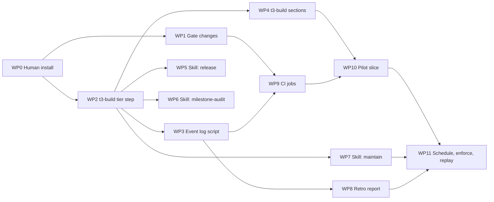

# Implementation plan

Turns [CONCEPT.md](CONCEPT.md) into a working team. Sources: section 7 "What is left to write", section 11 checklist, section 12 open points. Read by the implementing lead (`claude --agent lead`).

## State now

As of `origin/main` `86fdb09` (pull request 26). WP1 to WP9 and the follow-ups FU1 to FU14 are merged, each reviewed by Sol with tests written first by a separate agent. Open: WP0 (human), WP10 and WP11 (need a product repository and the human). Handover and the human-only list: [docs/HANDOVER.md](docs/HANDOVER.md).

| Done | Where |
|---|---|
| Skills copied, pinned, plus the new skills `release`, `milestone-audit`, `maintain` | `.agents/skills/` (`SOURCES.md`) |
| t3-build: tier step, T0 path, role table, sections, `references/`, `scripts/` (tier, event log, retro report, CI guards) | `.agents/skills/t3-build/` |
| Risk gate with `no_rating` list, `.opencode/` and `.cursor/` block rules, retarget re-run, auto-merge only into the default branch, early `pending` | `.agents/skills/t3-build/gate/` |
| CI templates and guard scripts (`ci`, `diff-guard`, `commit-trailers`, `agents-drift`) | `.agents/skills/t3-build/ci/`, `scripts/` |
| 16 Claude agents, 2 Codex agents, 2 OpenCode agents (20 files, match `models.md`) | `staging/` |
| Specs 001 to 021 | `docs/specs/` |
| `AGENTS.md`, `CLAUDE.md` | root |

Agents sit in `staging/` because `.claude/`, `.codex/` and `.opencode/` are guardrail folders: agents may not write them (the sandbox enforces it for `.claude/`). The human installs them (WP0). The installed `security-engineer.md` may still name `claude-fable-5-2`; `models.md` says `claude-opus-5-5`.

### Work package status

| WP | Status | Pull request |
|---|---|---|
| WP0 install, accounts | open, human | n/a |
| WP1 gate changes | merged | 1 |
| WP2 tier step | merged | 2 |
| WP3 event log | merged | 3 (hardening FU2: 10) |
| WP4 skill sections | merged | 4 (restructure FU4: 11) |
| WP5 release skill | merged | 5 |
| WP6 milestone-audit | merged | 6 |
| WP7 maintain | merged | 7 |
| WP8 retro report | merged | 8 (FU11 squash count: 23, FU12 per-lane metric: 24) |
| WP9 CI templates and guards | merged | 17 (FU9 branch filter: 18) |
| WP10 pilot slice | open, needs a product repository | n/a |
| WP11 schedule, enforce, replay | open, human decides | n/a |

Follow-ups merged: FU1 untrack pycache (9), FU3 tier hardening (12), FU5 gate block rules (13), FU6 and FU7 risk card (14, 15), FU8 dry-run sanitising (16), FU10 gate retarget (21), FU13 auto-merge base (25), FU14 early pending (26), `security-engineer` on Opus (19, 22), bulk worker narrowed in CONCEPT.md (20).

## Rules for the implementing agent

1. **Commit messages name the agents and efforts used**, one `Agent: <role> / <model> / <effort>` trailer each, plus `Tier:`. Format: `references/commit-trailers.md`. This applies to every commit of this plan.
2. Tier per work package is set below. Flow per tier: CONCEPT section 4. T2 packages and anything touching guardrail files end in a human merge.
3. One branch `agent/wp<N>-<slug>` per work package, one writer per checkout, tests first by a separate agent where code is written.
4. Evidence, not claims: command output in the report. Loop budgets: CONCEPT section 4.
5. Guardrail files (`AGENTS.md`, skills, agent files, gate policy, CI) are changed only by pull request that the human merges.

## Order

## Work packages

Agents and efforts are the ones that must appear in the commit trailers. `Lead` = Sonnet 5.5 high. Small edits of about 20 lines are done by the lead itself.

### WP0 Human install and accounts (human)

Checklist steps 1 to 6 of CONCEPT section 11.

- Run `./install-staging.sh`, then read the diff. It copies the agent files and links `.claude/skills` to `.agents/skills`. Test the whole-folder link: start Claude Code and confirm the skills list shows `t3-build`. Fallback: one link per skill.
- Check the model catalog in T3 Code against `references/models.md`. Fix the Gemini slug. Confirm the effort option keys.
- OpenRouter: dollar limit with monthly reset, zero-data-retention guardrail, provider allowlist, safety retention off.
- Product repository: branch protection, required checks `ci` and `risk-gate`, code owners for guardrail files. Secrets in a secret manager, test-only credentials.
- Sandbox settings: write to the worktree only, skill folders and secret paths denied, network allowlist.
- Read the Max and Pro plan terms on unattended automation before WP11.

Done when: `claude --agent lead` starts, lists `t3-build`, and `claude agents` shows all 16 roles.

### WP1 Risk gate changes, T2

Files: `.agents/skills/t3-build/gate/{risk-policy.toml,risk_gate.py,test_risk_gate.py,README.md}`. Three changes from CONCEPT section 7:

1. A separate `no_rating` path list for T0 (user documentation only, no tests, specs, runbooks or agent definitions). Only files with path floor 0 may be on it. Today the code sends every pull request without a rating to the review lane.
2. `.opencode/` in the agent-configuration "block" rule.
3. A commented template for payments and personal-data paths, filled per project from the threat model.

| Stage | Agent | Effort |
|---|---|---|
| Spec | spec-writer-t2 | high |
| Spec review | reviewer | medium |
| Tests | test-author-t2 | high |
| Implement | implementer | high |
| Code review | reviewer, max 5 rounds | medium |
| Security pass | reviewer-security and security-engineer | high, high |

Done when: the 35 existing tests plus new ones pass; a PR with only `no_rating` files and no rating lands in the auto lane; one with a spec or runbook file does not; `.opencode/` changes land in block.

### WP2 t3-build: tier step, T0 path, role table

Edit `.agents/skills/t3-build/SKILL.md`; add `references/{risk-tiers,budgets,brief}.md` and `scripts/tier.py`.

- Section 1 roles table points to `references/models.md` instead of naming models. Agents are named by role.
- New "Tier" step before scope: `tier.py <paths>` reads `risk-policy.toml`: guardrail file means human review, path rated 2 or 3 or a trigger (dependency, interface, schema) means T2, only `no_rating` files means T0, else T1. Judgment triggers (concurrency, untrusted input) are asked of the lead, the reviewer may raise the tier.
- T0 path: Haiku implementer, CI only, no model review. T1: clear spec needs no review. T2: Sol reviews the spec.
- `implementer` stays Opus. Sonnet takes T1 only when the `sonnet_t1_implementer` flag in `models.md` is on.
- `references/budgets.md` from CONCEPT loop budget table. `references/brief.md` from the briefs in section 9 of the skill.
- Replace the `Models:` footer with the trailers of `commit-trailers.md`.

| Stage | Agent | Effort |
|---|---|---|
| Spec | lead, short | high |
| `tier.py` tests | test-author | medium |
| `tier.py` | implementer | medium |
| Code review | reviewer | medium |

Tier: T2 (skill and agent configuration are guardrail files, human merges). Done when: `tier.py` classifies a fixture list of paths as T0, T1, T2 and "human" correctly, and the skill reads clean end to end.

### WP3 Event log script, T1

`scripts/log_event.py` in t3-build. One JSON line per stage to `~/.local/state/t3-build/<repo>/events.jsonl` with the fields of CONCEPT 6.12 (slice, tier, stage, role, model, effort, attempt, round, verdict, findings per severity, outcome, duration, tier raised, escalation, quota pause, date). It validates fields and adds the time. Dir mode 700. Lead calls it after each stage (add to SKILL.md in WP4).

Agents: test-author (medium), implementer (medium), reviewer (medium). Done when: valid input appends one line, invalid input exits non-zero and writes nothing.

### WP4 t3-build: refactoring, post-mortem, docs, log calls

Short sections in SKILL.md (CONCEPT 6.5, 6.6, 6.10):

- Refactoring: backlog reason required, characterisation tests first, small steps, extra reviewer question "did behaviour change anywhere?".
- Post-mortem after a severe or repeated bug: which gate missed it, fix the gate.
- Docs in the definition of done: docs-writer after the spec and diff, in the same pull request.
- The `log_event.py` call after every stage.

This is a lead-sized edit (more than 20 lines of prose, no code), so: lead (high) writes, reviewer (medium) reviews. Tier T2 by path (skills). Done when: each section fits the 200-line skill limit, details in `references/`.

### WP5 Skill: release, T2

`.agents/skills/release/SKILL.md` (CONCEPT 6.8): cut candidate, full machine gate, QA run, milestone audit, docs-writer for changelog and upgrade notes, one-page release brief (changes, every T2 change with its security verdict, accepted risks, open risks, declined findings, rollback, migrations named separately), human gate, human deploys, smoke test, rollback by runbook.

Agents: spec-writer-t2 (high), reviewer (medium), security-engineer (high) reviews the security parts. Done when: a dry run on the pilot repository produces a release brief of one page.

### WP6 Skill: milestone-audit, T2

`.agents/skills/milestone-audit/SKILL.md` (CONCEPT 6.7 layer 4): security-engineer audit with scanners and checklist, then `reviewer-security` as second key, findings ledger, human test recommendation for high stakes. Report goes to `docs/security/`, no exploit detail of unfixed findings.

Agents: spec-writer-t2 (high), reviewer-security (high). Done when: a dry run produces an audit report and a ledger.

### WP7 Skill: maintain, T1

`.agents/skills/maintain/SKILL.md` (CONCEPT 6.9): the five scheduled checks (dependencies weekly, advisories daily, flaky tests weekly, doc drift weekly, metrics monthly), report format with a tier per finding, nothing merges outside the gate. Runs on the `maintainer` agent.

Agents: spec-writer (medium), reviewer (medium). Done when: each check has a command, an output format and a tier rule.

### WP8 Retro report, T1

`scripts/retro_report.py`: aggregates `events.jsonl`, cross-checks against git (pull requests, reverts, failed checks after merge, `Agent:` trailers), prints the five calibration metrics of CONCEPT section 8 and the proposed changes table of 6.12. No model call. Data under 20 points per role and tier: "keep collecting".

Agents: test-author (medium), implementer (medium), reviewer (medium). Done when: a fixture log and fixture git history give the expected report.

### WP9 CI jobs, T2

In the product repository `.github/workflows/`, human-owned folder, so the human merges:

- `ci`: format, lint, types, tests, secret scan, dependency scan, static analysis, licence check.
- Diff guard: fails when test files are deleted or assertions shrink without a spec change.
- `risk-gate`: workflow from `gate/risk-gate.yml`, shadow mode, its own tests.
- `commit-trailers`: fails an `agent/*` commit without `Agent:` and `Tier:` trailers.
- `agents-drift`: `scripts/check_agents.py` fails when an agent file's model or effort differs from `references/models.md`.
- CI on agent branches runs without secrets.

Agents: spec-writer-t2 (high), test-author-t2 (high), implementer (high), reviewer (medium), reviewer-security and security-engineer (high). Done when: each job fails on a deliberate violation and passes on a clean branch.

### WP10 Pilot slice, T1

One real T1 slice through the whole delivery loop with logging from the first stage (checklist step 9). The lead writes a findings list of what in the skills, briefs or budgets did not work. Also test: whole-folder skills link, OpenCode duplicate skill listing, `delegate_task` to each agent file.

Done when: the slice is merged, `events.jsonl` has a line per stage, every commit has trailers, and the fix list is a pull request.

### WP11 Schedule, enforce, replay (human decides)

- Lead schedules the maintenance jobs and the monthly retro (`schedule_task`), after the plan terms are read.
- After about ten pull requests: the human compares the gate's lanes with their own decisions, then switches `risk-gate` to enforce.
- After the first finished T1 slices: replay test of Sonnet as T1 implementer on five to ten frozen slices. The lead proposes, the human flips `sonnet_t1_implementer`.

## Open points carried over

From CONCEPT section 12: plan terms for unattended runs, prices from search summaries, the untested whole-folder skills link, the gate not yet run on a real repository.
